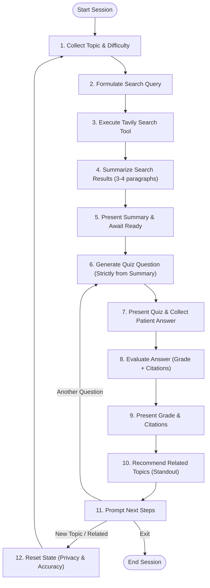

# HealthBot: AI-Powered Patient Education System
### MediTech Solutions — Intelligent Clinical Patient Education & Engagement

[](https://www.python.org/)
[](https://python.langchain.com/)
[](https://langchain-ai.github.io/langgraph/)
[](https://tavily.com/)
[](tests/)

---

## 1. Executive Summary & Clinical Context

MediTech Solutions is an innovative healthcare technology company providing software to hospitals and clinics globally. In healthcare systems worldwide, a critical gap exists in patient education:
- Patients frequently struggle to comprehend their diagnoses, treatment regimens, and discharge instructions.
- Health illiteracy leads to poor treatment adherence, preventable complications, high readmission rates, and elevated costs.

**HealthBot** addresses this challenge by providing an autonomous, reliable, and empathetic AI patient education workflow built on **LangChain** and **LangGraph**. HealthBot retrieves verified medical literature via **Tavily**, synthesizes strictly grounded 3-4 paragraph patient explanations, conducts comprehension checks, provides letter grades with verbatim citations from the summary, and enforces privacy-preserving state wipes between medical topics.

---

## 2. Architecture & LangGraph Workflow

HealthBot is architected as a sequential and conditional **LangGraph StateGraph** where each node adheres to the **Single Responsibility Principle**.

### Workflow Diagram (Mermaid)



---

## 3. Single-Responsibility Nodes

| Node Name | Single Responsibility | State Input | State Output |
| :--- | :--- | :--- | :--- |
| `collect_topic` | Captures medical topic & difficulty level | `topic`, `difficulty` | `topic`, `difficulty`, `messages` |
| `generate_query` | Formulates targeted clinical search query | `topic`, `difficulty` | `search_query` |
| `execute_search` | Calls Tavily Search via LangChain tool | `search_query` | `raw_search_results`, `search_context` |
| `summarize_results` | Synthesizes 3-4 paragraph grounded summary | `search_context`, `difficulty` | `summary`, `messages` |
| `present_summary` | Displays summary & prompts patient readiness | `summary` | `ready_for_quiz: True` |
| `generate_quiz` | Generates quiz question strictly from summary | `summary`, `difficulty` | `quiz_question`, `quiz_options` |
| `present_quiz` | Displays question & gathers patient's answer | `user_answer` | `user_answer`, `messages` |
| `evaluate_answer` | Grades answer (A-F) with citations from summary | `summary`, `quiz_question`, `user_answer` | `quiz_grade`, `quiz_explanation`, `citations`, `quiz_history` |
| `present_grade` | Communicates letter grade, explanation & citations | `quiz_grade`, `citations` | Evaluated state |
| `recommend_topics` | Standout: Suggests 3-4 related medical topics | `topic`, `summary` | `related_topics` |
| `ask_next_steps` | Prompts patient for next navigation step | User prompt | `next_action` |
| `reset_state` | Wipes prior topic data for privacy and accuracy | Prior state | Clean state |

---

## 4. LangGraph State Object

The state is defined via `HealthBotState(TypedDict)` with message reducer support:

```python
class HealthBotState(TypedDict, total=False):
    messages: Annotated[List[BaseMessage], add_messages]
    topic: str
    difficulty: str
    search_query: str
    raw_search_results: List[Dict[str, Any]]
    search_context: str
    summary: str
    ready_for_quiz: bool
    quiz_question: str
    quiz_options: List[str]
    quiz_history: List[Dict[str, Any]]
    user_answer: str
    quiz_grade: str
    quiz_explanation: str
    citations: List[str]
    related_topics: List[str]
    next_action: str
    session_active: bool
```

### Privacy-Preserving State Reset
To guarantee patient privacy and eliminate diagnostic cross-contamination when switching health topics, `reset_topic_state()` completely wipes topic-specific data, clinical search results, medical summaries, and previous quiz answers.

---

## 5. Standout Features

### 1. Educational Difficulty Settings
Patients can select their desired comprehension level:
- **Beginner:** 6th-grade reading level, relatable analogies, simplified language.
- **Intermediate:** Balanced clinical terminology with immediate definitions.
- **Advanced:** Detailed pathophysiology, pharmacology, and clinical nuances.

### 2. Multi-Question Quiz Assessment Loop
Patients can opt to answer multiple questions on the same topic. HealthBot tracks `quiz_history` and dynamically generates novel questions avoiding previously tested concepts.

### 3. Proactive Related Topics Recommendation
At the end of a topic, HealthBot suggests 3-4 clinically related topics (e.g. for "Hypertension", suggesting "DASH Diet", "Stroke Prevention", and "Hypertensive Retinopathy") allowing seamless one-click exploration.

---

## 6. Project Rubric Verification Matrix

| Rubric Criterion | Project Requirement | Implementation & Verification | Status |
| :--- | :--- | :--- | :---: |
| **Model & Tools LangGraph Configuration** | Proper OpenAI & Tavily configuration; OpenAI successfully calls Tavily search | Initialized `ChatOpenAI`, `TavilySearchResults`, bound tools in `src/config.py`, verified in `tests/test_tools.py`. | **PASS** |
| **Model Summarization of Search Results** | Model called Tavily; 3-4 paragraph summary using **NO OTHER knowledge or data sources** | Enforced in `src/prompts.py` and `summarize_results_node`; verified in `tests/test_prompts.py`. | **PASS** |
| **Quiz Question Creation & Grading** | Question strictly from summary; Grading strictly from summary with letter grade + justification + citations | Enforced in `generate_quiz_node` & `evaluate_answer_node`; verified in `tests/test_nodes.py`. | **PASS** |
| **LangGraph State** | State class created; updated across nodes; messages history; state reset between topics | Implemented in `src/state.py` with `reset_topic_state()`; verified in `tests/test_state.py`. | **PASS** |
| **Nodes, Edges, & Modifications** | Single-responsibility nodes; sequential & conditional edges; restart or exit workflow | 12 discrete nodes in `src/nodes.py`; conditional edges in `src/graph.py`; verified in `tests/test_workflow.py`. | **PASS** |
| **Standout Feature 1** | Difficulty setting (summary, quiz, grading) | Fully integrated (Beginner/Intermediate/Advanced) in prompts and CLI. | **PASS** |
| **Standout Feature 2** | Multiple quiz questions per topic | Loop edge in `src/graph.py` back to `generate_quiz`. | **PASS** |
| **Standout Feature 3** | Related subjects recommendations | Implemented via `recommend_topics_node` with patient selection. | **PASS** |

---

## 7. Setup & Installation

### Step 1: Clone Repository
```bash
git clone https://github.com/RicardoRobinson1410/HealthBot-Patient-Education.git
cd HealthBot-Patient-Education
```

### Step 2: Set up Virtual Environment & Install Dependencies
```bash
python -m venv .venv
# On Windows:
.venv\Scripts\activate
# On Linux/macOS:
source .venv/bin/activate

pip install -r requirements.txt
```

### Step 3: Configure API Keys in `config.env`
Create a file named `config.env` in the root directory (based on `config.env.example`):
```env
OPENAI_API_KEY="sk-your-openai-api-key"
TAVILY_API_KEY="tvly-your-tavily-api-key"
OPENAI_MODEL="gpt-4o-mini"
TAVILY_MAX_RESULTS="5"
```

Verify with python-dotenv as specified in instructions:
```python
from dotenv import load_dotenv
import os
load_dotenv('config.env')
assert os.getenv('OPENAI_API_KEY') is not None
assert os.getenv('TAVILY_API_KEY') is not None
```

---

## 8. Running HealthBot

### Interactive CLI Mode
Run the rich terminal interface:
```bash
python main.py
```

### Automated Walkthrough Demonstration
Run the end-to-end simulated demo verifying all rubric requirements:
```bash
python demo_runner.py
```

### Jupyter Notebook
Launch the complete interactive notebook:
```bash
jupyter notebook HealthBot.ipynb
```

### Running the Pytest Suite
Execute all 32 unit and integration tests:
```bash
pytest -v
```

---

## 9. Repository Structure

```
├── HealthBot.ipynb           # Complete interactive project notebook
├── config.env.example        # Template for API keys
├── config.env                # Local configuration (gitignored)
├── requirements.txt          # Pinned project dependencies
├── README.md                 # Project documentation & rubric verification
├── main.py                   # Interactive CLI application
├── demo_runner.py            # Automated demonstration runner
├── src/
│   ├── __init__.py           # Package marker
│   ├── config.py             # Configuration & tool initialization
│   ├── state.py              # HealthBotState TypedDict & privacy reset
│   ├── prompts.py            # Strictly grounded prompt templates
│   ├── tools.py              # Tavily search tool integration & fallback
│   ├── nodes.py              # Single-responsibility LangGraph nodes
│   ├── graph.py              # StateGraph assembly & conditional routing
│   └── bot.py                # HealthBot orchestrator class
└── tests/
    ├── __init__.py           # Test package marker
    ├── conftest.py           # Pytest fixtures & environment setup
    ├── test_config.py        # Configuration loading tests
    ├── test_state.py         # State schema & privacy reset tests
    ├── test_tools.py         # Tavily tool & formatting tests
    ├── test_prompts.py       # Grounding prompt constraints tests
    ├── test_nodes.py         # Single-responsibility node unit tests
    └── test_workflow.py      # End-to-end LangGraph execution tests
```

---

## 10. Author & License
- **Company:** MediTech Solutions
- **Developer:** Ricardo Robinson
- **License:** MIT License
